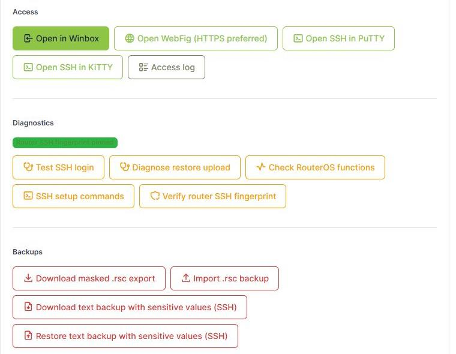

# MikroTik Tools for GLPI

**MikroTik Tools for GLPI** is a GLPI 11 and 12 plugin for working with MikroTik RouterOS devices from their network equipment records. It is published by [Connect IT](https://connectit.bg) and keeps the existing GLPI plugin key `winbox` for upgrade compatibility. The Windows installer, protocol names, and per-user data folder retain their existing technical names.

Version **1.0.2** is the current stable release. It includes the Teclib review corrections and the profile permission matrix, which was practically verified by the project owner on the GLPI 12.0.2 test instance. The source is licensed under **GPL-3.0-or-later**. See [changelog](CHANGELOG.md), [release notes](docs/RELEASE_NOTES_1.0.2.md), and [support information](SUPPORT.md).

## Features

- Per-device connection settings and access actions for WinBox, PuTTY, and WebFig.
- A per-device client setup link for users allowed to launch clients; the link is kept below the access buttons and opens in a new tab.
- Per-GLPI-profile permissions configured from the plugin settings page for device access, credential viewing/editing, diagnostics, backup/restore, and access logs.
- A Windows setup application that registers browser protocol handlers and installs only missing or incompatible managed clients. Existing compatible installations are left unchanged.
- GLPI access logging, including a per-device access log, subject to GLPI profile rights.
- RouterOS SSH host fingerprint verification and read-only policy/service diagnostics.
- Masked RouterOS `.rsc` export and import through RouterOS REST over HTTPS.
- Sensitive text export and restore over SSH/SFTP, with explicit confirmation and a restore-upload diagnostic.
- A single WebFig action that tries WWW-SSL first and uses WWW only when the TLS endpoint is unavailable.

### Interface screenshot

The screenshot omits the device address, device name, credentials, and account details.

See the [client setup instructions](client/READ%20ME%20INSTALL.txt) for Windows installation and launch steps.

## Requirements

- GLPI **11.x or 12.x** (tested on GLPI 11.0.9 and GLPI 12.0.2).
- PHP 8.2 or later, as required by the GLPI version in use.
- A supported RouterOS account and enabled service for each feature. Permissions vary by action; the plugin's diagnostics report the policies/services it can verify.
- For sensitive backup/restore, the GLPI server needs OpenSSH `ssh`, `sftp`, and `ssh-keyscan`, plus network access to the router's configured SSH port.
- For REST export/import, the GLPI server needs network access to the RouterOS REST API over HTTPS.

## Install or upgrade

1. For production, download the [MikroTik Tools for GLPI 1.0.2 release archive](https://github.com/connectitbg/mikrotik-winbox-glpi-plugin/releases/download/v1.0.2/glpi-winbox-plugin-1.0.2.zip) or choose another version from the [GitHub releases page](https://github.com/connectitbg/mikrotik-winbox-glpi-plugin/releases).
2. Back up the GLPI database and existing `plugins/winbox` directory.
3. Extract the archive into GLPI's `plugins` directory so the plugin remains at `plugins/winbox`.
4. In GLPI, open **Setup → Plugins**, install or upgrade **MikroTik Tools for GLPI**, then enable it.
5. Open each network equipment record, choose the **Winbox** tab, and enter the connection details for that device.

The display name is updated while the internal plugin key stays `winbox`; this lets GLPI recognize an existing installation. Do not rename the plugin directory.

## Windows client setup

1. Open `/plugins/winbox/InstallClient` on the GLPI server and download `Winbox-GLPI-Setup.exe` to the Windows computer used to access GLPI.
2. Double-click the installer. It registers the `mikrotik://`, `mikrotik-putty://`, and SSH diagnostic handlers for the signed-in Windows user. It also removes the obsolete per-user `mikrotik-kitty://` handler. Administrator rights, a separate `.reg` file, and manual PowerShell commands are not required.
3. The installer detects the available clients. Compatible existing applications are left unchanged. Missing or incompatible components are downloaded from their official HTTPS sources, verified against pinned SHA-256 hashes, and kept under `%LOCALAPPDATA%\Winbox-GLPI\clients`.
4. Wait for the completion message. Setup and launch information is written to `%LOCALAPPDATA%\Winbox-GLPI\winbox-glpi-launch.log`. Run the same installer again to repair handlers or retry a failed download.
5. In GLPI, open a device and choose **Open in Winbox**, **Open SSH in PuTTY**, or **Open WebFig**. Confirm the browser prompt to open an external application if it appears. Browser security prompts are not disabled.

WinBox and SSH handoff codes expire after 15 seconds. The handoff pages show a live countdown and disable the start link when the code expires. Codes are single-use and contain no router credentials.

The managed client set includes WinBox 4.5 and PuTTY/Plink 0.85. The installer does not replace compatible programs found elsewhere or remove separately installed applications. KiTTY integration was removed because its automatic password option would expose the saved password in the process command line; use PuTTY for saved-credential SSH access.

## Credentials and permissions

Router passwords are encrypted at rest with the GLPI security key. Back up and protect that key together with the GLPI database; without it, saved router passwords cannot be decrypted. In the plugin configuration page, administrators can delegate access actions, connection-field visibility, connection-field editing, diagnostics, backup/restore, and access-log visibility by existing GLPI profile. Initial defaults match the setup matrix: Admin and Super-Admin receive all six permissions; Supervisor and Technician receive access buttons and access-log visibility; all other profiles start with permissions disabled. Device-level GLPI read or update rights remain required for the corresponding action. Viewing connection fields includes viewing the decrypted password; editing credentials automatically includes view permission.

The plugin does not save router passwords to client files, the Windows credential store, or the registry. PuTTY and Plink receive the password through a per-launch, access-restricted Windows named pipe; the launcher does not create a password file. WinBox's documented command-line interface requires the password as a process argument for automatic login. Local processes or administrators may inspect a running process command line. WinBox's native **Keep Password** and **Autosave session** settings may retain session data on that workstation. The plugin does not change these WinBox settings; their behavior is an open item for Teclib review. Native-client automatic login cannot guarantee zero workstation exposure or storage; server-side remote access is required for that guarantee. Keep GLPI on HTTPS and grant launch permission only to trusted staff.

The upgrade encrypts live database rows. Database backups created before the upgrade still contain plaintext router passwords and must continue to be protected accordingly.

Launch handoffs use single-use, time-limited codes. The browser URI contains the code rather than the password. PuTTY receives the saved password from a private Windows named pipe, not a disk file or command-line argument. WinBox receives the password as a command-line argument, as required by its documented CLI. Regular SSH launch events confirm only that the client process started; they do **not** prove RouterOS authenticated the user.

The global `mikrotik_access.log` is available under **Administration → Logs → Log files**. A per-device **Access log** button is shown only to users with the required GLPI log-read permission and access to that device. Credentials and launch codes are not written to the access log. These audit logs are retained in GLPI's log directory when the plugin is uninstalled; remove them separately only if retention policy allows.

## Backup and restore actions

The device's **Winbox** tab groups actions into access, diagnostics, and backup sections. The four backup actions are:

- **Download masked .rsc export** — exports a RouterOS script with sensitive values masked through REST over HTTPS.
- **Import .rsc backup** — checks an uploaded script with a dry run and imports it only after explicit confirmation.
- **Download text backup with sensitive values (SSH)** — uses `/export show-sensitive terse` over verified SSH.
- **Restore text backup with sensitive values (SSH)** — uploads the selected `.rsc` over SFTP, performs a dry run where the RouterOS version supports it, and imports after explicit confirmation.

Sensitive text exports contain readable configuration secrets and must be protected as confidential files. RouterOS user passwords and SSH private keys are not recoverable from these text exports. A restore can change network settings or make the router unreachable; use a current backup prepared for that device and RouterOS version.

SSH actions require a pinned server fingerprint. Verify the displayed fingerprint against a trusted record before pinning it. The restore-upload diagnostic uploads a randomly named temporary probe and attempts to remove it; it does not import configuration. If cleanup cannot be confirmed, review RouterOS **Files** for the reported temporary filename.

## Diagnostics and configuration

The orange diagnostic actions report the `ssh`, `read`, `sensitive`, `ftp`, and `write` user policies where the active RouterOS group can be verified, and check configured FTP, API, API-SSL, WWW, WWW-SSL, and SSH service endpoints. These checks do not change RouterOS configuration. A transport check confirms reachability only; it does not verify API or WebFig credentials. The `write` policy is inspected without issuing a write command.

An optional SSH setup helper can generate RouterOS commands for an administrator to review and run manually. Those commands may change SSH service and firewall settings. They are never sent or executed automatically by the plugin; review them carefully and use RouterOS Safe Mode when applying remote firewall changes.

## Troubleshooting and security

- Windows setup and launch log: `%LOCALAPPDATA%\Winbox-GLPI\winbox-glpi-launch.log`.
- SSH diagnostic log: `%LOCALAPPDATA%\Winbox-GLPI\winbox-glpi-ssh-test.log`.
- For SFTP restore failures, use **Diagnose restore upload** in GLPI; no diagnostic file download is needed.
- If an SSH login is rejected, verify the device's saved username/password and RouterOS SSH authentication policy. The plugin does not bypass RouterOS authentication.
- The Windows executable is unsigned. Use it only when downloaded from a trusted GLPI server. Production deployments should sign client binaries with the publisher's code-signing certificate.
- Protect downloaded backups, use HTTPS, and grant each plugin permission only to appropriate GLPI profiles.

## Bug reports

Use the [GitHub bug report form](https://github.com/connectitbg/mikrotik-winbox-glpi-plugin/issues/new?template=bug_report.yml). Never include passwords, launch codes, customer data, public router addresses, or unredacted configuration backups.
